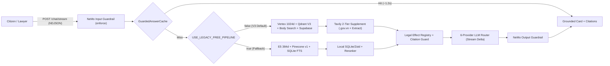

<div align="center">
  
  <h1>VietLex</h1>
  <p><strong>Evidence-Grounded Vietnamese Legal Research &amp; RAG Platform</strong></p>
  <p>
    <a href="https://vietlex-legal-rag.vercel.app">Live App</a> ·
    <a href="README.md">Tiếng Việt</a> ·
    <a href="docs/CURRENT_ARCHITECTURE.md">Architecture</a> ·
    <a href="FEATURE_STATUS.md">Feature Status</a> ·
    <a href="docs/evaluation/runs/v4-fullstack-upgrade-20261118/REPORT.md">V4 Evaluation</a>
  </p>
</div>

> [!IMPORTANT]
> **Legal Disclaimer & Release Boundary (`2026-11-18` · branch `feat/vietlex-v4-fullstack-upgrade`):**
> VietLex is a **legal research and contract-review workbench** — it is not an official government legal database and does not replace qualified human legal counsel. Responses include explicit source citations, effective-status metadata (`legal_effect`), and warnings whenever amendment or transition chains are unverified (`unverified`).
> The V4 upgrade on this branch is synced 1:1:1 across Free-Tier Qdrant/Supabase cloud stores and verified via the offline suite, 31-question live rubric, and Golden-50 benchmarks; **deployment to the production Vercel domain ([vietlex-legal-rag.vercel.app](https://vietlex-legal-rag.vercel.app)) has not yet been executed**, and general production readiness across the full 518,255-record historical corpus is not claimed.

---

## V4 Key Capabilities

| Area | Core Capability | Primary Modules |
| :--- | :--- | :--- |
| **Hybrid Vector & Full-Text** | Combines dense `gemini-embedding-2` (1024d) + sparse IDF on Qdrant V3 with equal reciprocal-rank `RRF + DBSF` fusion, reconciled 1:1:1 with Qdrant Body Search and read-only Supabase RLS | [`vertex_qdrant_retrieval.py`](app/services/vertex_qdrant_retrieval.py) · [`curated_normative_corpus.py`](app/ingestion/curated_normative_corpus.py) |
| **Two-Tier Tavily Web RAG** | Supplements corpus gaps with live `Tavily Search` + `Extract`: Tier 1 strictly trusts `.gov.vn` primary sources (excluding `duthao.*` drafts); Tier 2 (`thuvienphapluat.vn`, etc.) acts purely as pivot hints to locate Tier-1 official instruments | [`tavily_search.py`](app/services/tavily_search.py) · [`web_source_tiers.py`](app/services/web_source_tiers.py) |
| **6-Provider Router & Streaming** | Supports Google Vertex AI, Gemini Direct, Groq, OpenRouter, NVIDIA NIM, and OmniGate via real-time `POST /chat/stream` NDJSON + `AbortController`. Unrestricted provider/model & `web_mode` in `development`/`test`/verified `admin`; `production` public traffic preserves `ReviewerDemoMiddleware` quotas | [`direct_llm.py`](app/services/direct_llm.py) · [`reviewer_demo.py`](app/services/reviewer_demo.py) · [`routes.py`](app/api/routes.py) |
| **Mandatory Guardrails & Cache** | NeMo Guardrails (`input` + `output`) enforce unconditionally on public chat; `citation_clause_guard` strips ungrounded document numbers; `GuardedAnswerCache` serves only pre-guarded answers (`~1.2s` hit) | [`serverless_guardrails.py`](app/services/serverless_guardrails.py) · [`citation_clause_guard.py`](app/services/citation_clause_guard.py) · [`guarded_answer_cache.py`](app/services/guarded_answer_cache.py) |
| **Lawyer Intelligence Workspace** | DOCX upload preserving `<w:numPr>` clause numbering and nested `<w:tbl>` tables, word-level inline Redline (`<del>`/`<ins>`), sequential batch contract review + CSV export, claim verification, and Decree-30/2020/NĐ-CP A4 `.docx` reports | [`workspace_documents.py`](app/services/workspace_documents.py) · [`document_redline.py`](app/services/document_redline.py) · [`report_deliverables.py`](app/services/report_deliverables.py) |

---

## Architecture & Corpus Scope



| Contract / Dataset | Runtime Scope | Boundaries |
| :--- | :--- | :--- |
| **`USE_LEGACY_FREE_PIPELINE=false`** *(Default)* | Vertex `gemini-embedding-2` (1024d), Qdrant `vietlex-legal-rag-v3-vertex-1024` (dense + sparse IDF, `RRF + DBSF`), 1:1:1 synced with Qdrant Body Search and Supabase `public.legal_documents` | Curated modern normative subset, not the full `518,255`-row historical archive |
| **`USE_LEGACY_FREE_PIPELINE=true`** *(Legacy)* | Qdrant Cloud `intfloat/multilingual-e5-small` (384d), Pinecone `vietlex-legal-rag-v1` / `legal-documents-v1`, local SQLite/Zstandard + number/title FTS; blocks Google Cloud/Vertex prior to client creation | Never silently cross-falls back to V3 |
| **Pinned Third-Party Source** | [`vohuutridung/vietnamese-legal-documents`](https://huggingface.co/datasets/vohuutridung/vietnamese-legal-documents), revision `4d4e10b201544e8a4c49a1d3fa496595a7d486d0` (`518,255` records) | Stored locally only when running ingestion; excluded from serverless bundles |
| **Curated V4 Cloud Sync (`curated_v4`)** | **`6,541` normative instruments (`224,999` V3 points)**: 100% uncapped `Điều` articles across Tier A (`627` Laws/Codes 1995–2026), Tier B (`1,712` Decrees 2015–2026), Tier D (`2,288` Central Resolutions 2015–2026), and Tier E (`1,914` Circulars 2020–2026); Qdrant disk `2.366 / 4.00 GiB`, RAM `274.22 / 1,024 MiB`, all 4 collections `green` | [`curated_v4_verify_receipt.json`](data/ingestion/curated_v4_verify_receipt.json) · Excludes English doc `387595`; tags `44` superseded statutes `validity_hint="superseded"` |

---

## Measured Verification (`2026-11-18`)

All checks below ran after the final code edit on `feat/vietlex-v4-fullstack-upgrade`, with immutable artifacts stored under [`docs/evaluation/runs/`](docs/evaluation/runs/).

| Check / Benchmark | Previous Baseline (`2026-11-03`) | V4 Measured (`2026-11-18`) | Scope & Receipt |
| :--- | ---: | ---: | :--- |
| **Ruff / Node JS / Pytest (offline)** | `2,240` / `22 passed` | **`0` lint · `25/25` Node · `2,530 passed`** | `6` `@pytest.mark.live` deselected (`327.29s`) |
| **31-Question Vietnamese Legal Rubric** | `13 / 31 PASS` (`41.9%`) | **`30 / 31 PASS` (`96.8%`)** | `18/18` prior failures resolved; 1 transient `503` on `B02` ([REPORT.md](docs/evaluation/runs/v4-fullstack-upgrade-20261118/REPORT.md)) |
| **Golden-50 Guardrails & Technical Errors** | `50/50` safe · `49/50 STOP` | **`50/50` safe · `50/50 STOP` · `0%` err** | `guardrails=enforce`, `chat_service_v1` |
| **Golden-50 Doc / Article / Clause Recall@3** | `1.000` / `0.982` / `0.923` | **`0.9250` / `0.9259` / `0.6154`** | `Doc Recall@24 = 1.0000` (`53/53`); `40/50` gold-labeled |
| **Golden-50 Token Recall / Token F1** | `0.9577` / `0.2323` | **`0.9721` / `0.2356`** | `exact_match = 0.0000`; `mixed_claim_refusal = 2/50` ([report.md](docs/evaluation/runs/answer-golden50-v4-remediated-20261118/report.md)) |
| **Golden-50 Ragas `0.4.3` (Accuracy / Recall)** | `0.9000` / `0.9490` | **`0.8900` / `0.9333`** | `context_precision = 0.8486` (`41.58/49`, 1 Groq `429`), `faithfulness = 0.7115` ([REPORT.md](docs/evaluation/runs/ragas-golden50-v4-remediated-20261118/REPORT.md)) |
| **Golden-50 Latency `P50` / `P95`** | `56.95s` / `62.65s` | **`8.96s` / `44.82s`** | **`6.36x` faster** median latency |

---

## Local Setup & Commands

Requires **Python 3.12** (`>=3.12,<3.13` per [`pyproject.toml`](pyproject.toml)) and optionally **Node.js `>=18`** for UI race/stream tests:

```powershell
py -3.12 -m venv .venv
.\.venv\Scripts\Activate.ps1
python -m pip install -r requirements-demo.lock
python -m pip install . --no-deps
Copy-Item .env.example .env
python -m uvicorn app.main:app --reload --port 8000
```

Configure `.env` (never commit `.env`, `.secrets/`, `*.sqlite3`, or `SUPABASE_SERVICE_ROLE_KEY`):
- **Retrieval & Storage:** `USE_LEGACY_FREE_PIPELINE=false`, `QDRANT_URL`, `QDRANT_API_KEY`, `SUPABASE_URL`, `SUPABASE_PUBLISHABLE_KEY`, `MONGO_URL`, `SERVERLESS_ONLINE_ONLY=true`
- **Providers & Web Grounding:** `GOOGLE_APPLICATION_CREDENTIALS` (or `GOOGLE_SERVICE_ACCOUNT_JSON`), optional `GEMINI_API_KEY`, `GROQ_API_KEY`, `OPENROUTER_API_KEY`, `NVIDIA_API_KEY`, and `TAVILY_API`
- **Security:** `APP_ENV=development` locally (`production` online with `WEB_SESSION_SECRET`)

### Verification & Evaluation

```powershell
python -m ruff check app tests scripts
python -m pytest -m "not live" -q
node --test tests/*.test.cjs

# Live Golden-50 answer evaluation (incurs provider calls; always pick a fresh run-id)
python run_answer_eval.py `
  --dataset docs/evaluation/golden50-v3/cases.json `
  --sidecar docs/evaluation/golden50-v3/labels.json `
  --backend production --ranking rrf-dbsf --profile separated_intent `
  --rewrite off --guardrails enforce --reranker current `
  --concurrency 2 --gold-policy none --judge none `
  --run-id YOUR_UNIQUE_RUN_ID
```

> [!CAUTION]
> Full-corpus ingestion, Pinecone/Qdrant collection deletion, and Free-Tier index rebuilds (`scripts/rebuild_curated_free_tier.py reclaim|sync`) are destructive operations requiring explicit authorization. See [`docs/runbooks/DEPLOYMENT.md`](docs/runbooks/DEPLOYMENT.md) and [`AGENTS.md`](AGENTS.md) for deployment and safety rules.
