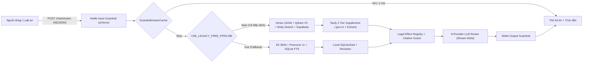

<div align="center">
  
  <h1>VietLex</h1>
  <p><strong>Hệ thống Nghiên cứu &amp; Hỏi đáp Pháp luật Việt Nam có Truy nguồn (Evidence-Grounded Legal RAG)</strong></p>
  <p>
    <a href="https://vietlex-legal-rag.vercel.app">Live App</a> ·
    <a href="README.en.md">English</a> ·
    <a href="docs/CURRENT_ARCHITECTURE.md">Kiến trúc kỹ thuật</a> ·
    <a href="FEATURE_STATUS.md">Trạng thái tính năng</a> ·
    <a href="docs/DOCUMENTATION_INDEX.md">Danh mục tài liệu</a>
  </p>
</div>

> [!IMPORTANT]
> **Giới hạn pháp lý & Trạng thái phát hành (`2026-11-18` · nhánh `feat/vietlex-v4-fullstack-upgrade`):**
> VietLex là **công cụ hỗ trợ nghiên cứu và rà soát văn bản pháp luật** — không phải cơ sở dữ liệu pháp luật chính thức và không thay thế ý kiến tư vấn của luật sư. Mọi phản hồi đều đi kèm trích dẫn nguồn, trạng thái hiệu lực (`legal_effect`) và cảnh báo khi chuỗi sửa đổi/chuyển tiếp chưa được con người xác thực (`unverified`).
> Toàn bộ mã nguồn V4 đã đồng bộ 1:1:1 trên kho đám mây Qdrant/Supabase Free Tier và vượt qua cổng kiểm thử cục bộ + Golden-50 + 31 câu hỏi thực tế; bản nâng cấp trên nhánh này **chưa được triển khai lại lên domain production** ([vietlex-legal-rag.vercel.app](https://vietlex-legal-rag.vercel.app)), và tính sẵn sàng production toàn diện trên toàn bộ `518,255` hồ sơ lịch sử chưa được khẳng định.

---

## Điểm nổi bật của Kiến trúc V4

| Phân hệ | Năng lực cốt lõi | Thành phần chính |
| :--- | :--- | :--- |
| **Hybrid Vector & Full-Text** | Kết hợp Dense `gemini-embedding-2` (1024d) + Sparse IDF trên Qdrant V3 theo công thức trộn `RRF + DBSF`, đồng bộ 1:1:1 với Qdrant Body Search và Supabase RLS read-only | [`vertex_qdrant_retrieval.py`](app/services/vertex_qdrant_retrieval.py) · [`curated_normative_corpus.py`](app/ingestion/curated_normative_corpus.py) |
| **Tavily Official Web RAG (2 Tầng)** | Tự động bổ sung quy định mới ngoài kho bằng `Tavily Search` + `Extract`: Tầng 1 chỉ tin cậy tên miền `.gov.vn` (loại trừ `duthao.*`), Tầng 2 (`thuvienphapluat.vn`, v.v.) chỉ dùng làm gợi ý xoay trục tìm văn bản gốc Tầng 1 | [`tavily_search.py`](app/services/tavily_search.py) · [`web_source_tiers.py`](app/services/web_source_tiers.py) |
| **Định tuyến 6 AI Provider & Streaming** | Hỗ trợ Google Vertex AI, Gemini Direct, Groq, OpenRouter, NVIDIA NIM và OmniGate qua `POST /chat/stream` (NDJSON real-time + `AbortController`). Môi trường `development`/`test`/tài khoản `admin` mở tự do provider & `web_mode`; môi trường `production` công khai giữ nguyên quota `ReviewerDemoMiddleware` | [`direct_llm.py`](app/services/direct_llm.py) · [`reviewer_demo.py`](app/services/reviewer_demo.py) · [`routes.py`](app/api/routes.py) |
| **Guardrails & Cache Kiểm duyệt** | NeMo Guardrails (`input` + `output`) luôn ở chế độ `enforce` cho public chat; `citation_clause_guard` loại bỏ số hiệu không có trong ngữ cảnh; `GuardedAnswerCache` chỉ trả cache cho câu trả lời đã qua kiểm duyệt | [`serverless_guardrails.py`](app/services/serverless_guardrails.py) · [`citation_clause_guard.py`](app/services/citation_clause_guard.py) · [`guarded_answer_cache.py`](app/services/guarded_answer_cache.py) |
| **Lawyer Intelligence Workspace** | Upload `.docx` bảo toàn đánh số điều khoản (`<w:numPr>`) & bảng lồng nhau (`<w:tbl>`), **Redline từng từ** (`<del>`/`<ins>`), rà soát hợp đồng theo lô + xuất CSV, kiểm chứng tuyên bố, và xuất báo cáo `.docx` **khổ A4 chuẩn Nghị định 30/2020/NĐ-CP** | [`workspace_documents.py`](app/services/workspace_documents.py) · [`document_redline.py`](app/services/document_redline.py) · [`report_deliverables.py`](app/services/report_deliverables.py) |

---

## Kiến trúc & Phạm vi Dữ liệu



### Hợp đồng hai tuyến truy hồi & Dữ liệu đám mây

Hệ thống phân tách rạch ròi hai tuyến qua biến boolean `USE_LEGACY_FREE_PIPELINE` (không tự động cross-fallback ngầm giữa hai hợp đồng):

| Hạng mục | Chi tiết vận hành thực tế | Giới hạn phạm vi |
| :--- | :--- | :--- |
| **`USE_LEGACY_FREE_PIPELINE=false`** *(Mặc định)* | Vertex `gemini-embedding-2` (1024d), Qdrant collection `vietlex-legal-rag-v3-vertex-1024` (dense + sparse IDF, trộn `RRF + DBSF`), đồng bộ 1:1:1 với Qdrant Body Search và Supabase `public.legal_documents` | Không phải toàn bộ `518,255` văn bản lịch sử trên gói Qdrant Free Tier |
| **`USE_LEGACY_FREE_PIPELINE=true`** *(Legacy / Offline)* | Qdrant Cloud inference `intfloat/multilingual-e5-small` (384d), Pinecone `vietlex-legal-rag-v1` / `legal-documents-v1`, SQLite/Zstandard và FTS số hiệu/tiêu đề; chặn mọi lời gọi Google Cloud/Vertex trước khi khởi tạo client | Reranker: ColBERT (`answerai-colbert-small-v1`), fallback `bge-reranker-v2-m3` |
| **Dữ liệu gốc ghim phiên bản** | Dataset [`vohuutridung/vietnamese-legal-documents`](https://huggingface.co/datasets/vohuutridung/vietnamese-legal-documents), revision `4d4e10b201544e8a4c49a1d3fa496595a7d486d0` (`518,255` hồ sơ) | Tệp thô chỉ nằm cục bộ, không đóng gói vào ảnh deploy serverless |
| **Kho đám mây V4 đã đồng bộ (`curated_v4`)** | **`6,541` văn bản quy phạm trọng tâm (`224,999` điểm V3)**: giữ **100% trọn vẹn các `Điều`** không cắt trần ở Tầng A (`627` Luật/Bộ luật/Hiến pháp 1995–2026), Tầng B (`1,712` Nghị định 2015–2026), Tầng D (`2,288` Nghị quyết TW 2015–2026) và Tầng E (`1,914` Thông tư 2020–2026); Qdrant disk `2.366 / 4.00 GiB`, RAM `274.22 / 1,024 MiB`, cả 4 collection ở trạng thái `green`, `SHA-256` khớp tuyệt đối 1:1:1 | [`curated_v4_verify_receipt.json`](data/ingestion/curated_v4_verify_receipt.json) · Loại trừ bản dịch tiếng Anh (`387595`); gắn nhãn `validity_hint="superseded"` cho `44` văn bản bị thay thế |

---

## Kết quả Đánh giá & Kiểm thử (`2026-11-18`)

Mọi kết quả dưới đây được ghi nhận sau dòng code chỉnh sửa cuối cùng trên nhánh `feat/vietlex-v4-fullstack-upgrade`, với các thư mục đánh giá bất biến lưu tại [`docs/evaluation/runs/`](docs/evaluation/runs/).

### 1. Cổng kiểm thử tự động & Nghiệm thu 31 câu hỏi thực tế

| Cổng kiểm thử | Kết quả | Tham chiếu |
| :--- | :--- | :--- |
| **Static Lint (`ruff`)** | **`0` lỗi** (`All checks passed!`) | `python -m ruff check app tests scripts` |
| **Frontend JS Tests (`node --test`)** | **`25 passed, 0 failed`** | [`tests/*.test.cjs`](tests/chat_stream_ui.test.cjs) |
| **Backend Provider-Free Suite (`pytest`)** | **`2,530 passed, 0 failed, 6 deselected`** (`327.29s`) | Loại trừ 6 test `@pytest.mark.live` |
| **Rubric 31 câu hỏi pháp luật thực tế** | **`30 / 31 PASS` (`96.8%`)** so với baseline **`13 / 31`** (`18/18` ca trượt cũ đã sửa; `B02` gặp 1 nhịp `HTTP 503` upstream ở lượt chạy chính nhưng đạt `200 OK` ở lượt liền trước) | [Báo cáo nghiệm thu V4](docs/evaluation/runs/v4-fullstack-upgrade-20261118/REPORT.md) |
| **Fullness 11 Đạo luật/Nghị định trụ cột** | **100% Điều** được xác nhận trên Qdrant Cloud V3 (`BLDS 2015: 689/689`, `BLLĐ 2019: 220/220`, `BLHS 2015: 425/425`, `Luật Đất đai 2024: 260/260`, `Luật BHXH 2024: 141/141`, `NĐ 168/2024: 55`, `NĐ 293/2025: 5`, `Hiến pháp HN 2025: 120`, `NQ 110/2025`, `Luật QLT 2025: 53`) | [Verify Receipt](data/ingestion/curated_v4_verify_receipt.json) |

### 2. Đối chiếu Bộ chuẩn Golden-50 (`Code Metrics 3.3.0` & `Ragas 0.4.3`)

Golden-50 đánh giá 50 câu hỏi thực định & đa chặng (Luật BVMT `72/2020/QH14` & Luật Doanh nghiệp `59/2020/QH14`) qua `chat_service_v1` với `guardrails=enforce`; lượt Ragas `0.4.3` chấm độc lập trên đúng 50 câu trả lời & ngữ cảnh đã lưu (không giữ online semaphore).

| Chỉ số Golden-50 | Baseline (`2026-11-03`) | V4 Sau sửa (`2026-11-18`) | Tử số / Mẫu số (`V4 Final`) | Ghi chú phạm vi |
| :--- | ---: | ---: | :---: | :--- |
| **Generation `STOP` / Guardrails Safe** | `49/50` · `50/50` | **`50/50` · `50/50`** | `50 / 50` | Không lỗi kỹ thuật retrieval/reranker (`0%`) |
| **Document Recall @ 24 / @ 10 / @ 3** | `1.0000` / `1.0000` / `1.0000` | **`1.0000` / `0.9750` / `0.9250`** | `53/53` · `51/53` · `49/53` | `40/50` ca có gold (`10` `no_verified_gold_label`) |
| **Article Recall @ 3 / Clause Recall @ 3** | `0.9815` / `0.9231` | **`0.9259` / `0.6154`** | `28/30` · `9/14` | `27` ca có gold Điều; `13` ca có gold Khoản |
| **Multi-hop all-required coverage** | `0.9500` (`38/40`) | **`0.8000`** | `32 / 40` | Nhiều Nghị định hướng dẫn dài mở khóa full Điều cạnh tranh top-3 |
| **Answer `token_recall` / `token_f1`** | `0.9577` / `0.2323` | **`0.9721` / `0.2356`** | `48.61/50` · `11.78/50` | `exact_match = 0.0000` do văn phong giải thích kèm trích dẫn |
| **`citation_precision` / `mixed_claim_refusal`** | `0.9679` / `0.0000` | **`0.8560` / `0.0400`** | `42.8/50` · `2/50` | Tham chiếu: [Báo cáo Code 3.3.0](docs/evaluation/runs/answer-golden50-v4-remediated-20261118/report.md) |
| **Ragas `answer_accuracy`** *(LLM-Judge)* | `0.9000` (`45.0/50`) | **`0.8900`** | `44.50 / 50` | Độ phủ `100%` (`0` skipped) |
| **Ragas `context_recall`** *(LLM-Judge)* | `0.9490` (`46.5/49`) | **`0.9333`** | `46.67 / 50` | Độ phủ `100%` (`0` skipped) |
| **Ragas `context_precision`** *(LLM-Judge)* | `0.8708` (`42.67/49`) | **`0.8486`** | `41.58 / 49` | `1` ca skip (`case_015` do TPM `429` của Groq) |
| **Ragas `faithfulness`** *(LLM-Judge)* | `0.8333` (`40.83/49`) | **`0.7115`** | `35.58 / 50` | Chi tiết: [Báo cáo Ragas 0.4.3](docs/evaluation/runs/ragas-golden50-v4-remediated-20261118/REPORT.md) |
| **Độ trễ `P50` / `P95` (`t_total`)** | `56.95s` / `62.65s` | **`8.96s` / `44.82s`** | `50` ca | Nhanh hơn **`6.36x`** ở trung vị |

> [!NOTE]
> Lượt chạy chẩn đoán ban đầu trước khi sửa lỗi hậu truy hồi (`answer-golden50-v4-curated-20261118` và `ragas-golden50-v4-curated-20261118`) được lưu giữ nguyên trạng trong `docs/evaluation/runs/` để đảm bảo tính minh bạch tái lập theo `AGENTS.md`. Điểm tương đồng từ vựng (`token_f1`) và Ragas LLM-Judge là bằng chứng đánh giá thứ cấp, **không thay thế thẩm định pháp lý của con người**.

---

## Cài đặt & Khởi chạy Local

### Yêu cầu hệ thống
- **Python `3.12.x`** (`>=3.12,<3.13`, theo [`pyproject.toml`](pyproject.toml))
- **Node.js `>=18`** *(tùy chọn, dùng cho suite test giao diện `tests/*.test.cjs`)*

### Thiết lập nhanh (Windows PowerShell)

```powershell
py -3.12 -m venv .venv
.\.venv\Scripts\Activate.ps1
python -m pip install -r requirements-demo.lock
python -m pip install . --no-deps
Copy-Item .env.example .env
python -m uvicorn app.main:app --reload --port 8000
```

Truy cập giao diện tại `http://127.0.0.1:8000`.

### Cấu hình biến môi trường cốt lõi (`.env`)

Tham khảo đầy đủ tại [`.env.example`](.env.example). Dưới đây là các nhóm biến tối thiểu để vận hành đầy đủ tính năng:

| Nhóm cấu hình | Biến môi trường tiêu biểu | Vai trò |
| :--- | :--- | :--- |
| **Tuyến truy hồi & Chế độ** | `USE_LEGACY_FREE_PIPELINE=false`, `APP_ENV=development`, `SERVERLESS_ONLINE_ONLY=true` | Chọn Qdrant V3 + Supabase online (hoặc đặt `APP_ENV=production` nếu muốn kích hoạt toàn bộ auth/Mongo/quota demo) |
| **Vector DB & Lưu trữ** | `QDRANT_URL`, `QDRANT_API_KEY`, `SUPABASE_URL`, `SUPABASE_PUBLISHABLE_KEY`, `MONGO_URL` | Truy hồi vector V3 (`1024d`), đọc toàn văn văn bản pháp luật, lưu phiên chat & workspace |
| **AI Providers & Web Search** | `GOOGLE_APPLICATION_CREDENTIALS` (hoặc `GOOGLE_SERVICE_ACCOUNT_JSON`), `GEMINI_API_KEY`, `GROQ_API_KEY`, `OPENROUTER_API_KEY`, `NVIDIA_API_KEY`, `TAVILY_API` | Sinh câu trả lời, guardrails và tìm/đọc nguồn web `.gov.vn` hai tầng qua Tavily |
| **Bảo mật & Triển khai** | `WEB_SESSION_SECRET`, `REVIEWER_DEMO_MODE`, `ADMIN_USERNAME`, `ADMIN_PASSWORD` | Ký session CSRF/auth và tách biệt quyền hạn giữa khách công khai (`production`) và admin |

> [!WARNING]
> **Bảo mật & Phạm vi dữ liệu:** Tuyệt đối không commit tệp `.env`, thư mục `.secrets/`, `*.sqlite3` hoặc khóa `SUPABASE_SERVICE_ROLE_KEY`. Việc khởi chạy UI local không tự tải corpus `518,255` văn bản và không tự tạo/xóa index trên đám mây.

---

## Kiểm thử, Đánh giá & Quản trị Dữ liệu

```powershell
# 1. Kiểm tra lint & format (Ruff)
python -m ruff check app tests scripts

# 2. Chạy toàn bộ test Python ngoại tuyến (không gọi live provider trả phí)
python -m pytest -m "not live" -q

# 3. Chạy test Frontend JS / Streaming NDJSON UX
node --test tests/*.test.cjs

# 4. Chạy benchmark Golden-50 deterministic (có gọi live Vertex/Qdrant & LLM; dùng run-id mới)
python run_answer_eval.py `
  --dataset docs/evaluation/golden50-v3/cases.json `
  --sidecar docs/evaluation/golden50-v3/labels.json `
  --backend production --ranking rrf-dbsf --profile separated_intent `
  --rewrite off --guardrails enforce --reranker current `
  --concurrency 2 --gold-policy none --judge none `
  --run-id YOUR_UNIQUE_RUN_ID
```

> [!CAUTION]
> **Thao tác phá hủy / Nạp dữ liệu đám mây:** Script tái lập kho Free-Tier [`scripts/rebuild_curated_free_tier.py`](scripts/rebuild_curated_free_tier.py) (`plan` / `reclaim` / `sync` / `verify`) thực hiện thu hồi collection/bảng cũ và nạp lại vector đám mây. **Chỉ chạy `reclaim` hoặc `sync` khi có quyền quản trị rõ ràng và đã kiểm tra `plan` trước.** Xem thêm quy chuẩn vận hành và triển khai Vercel tại [`docs/runbooks/DEPLOYMENT.md`](docs/runbooks/DEPLOYMENT.md) và [`docs/PRODUCTION_OPERATIONS.md`](docs/PRODUCTION_OPERATIONS.md).

---

## Cấu trúc Dự án

```text
ProfessionalLegalRAG/
├── app/
│   ├── api/                 # FastAPI routers: chat stream, tìm kiếm, văn bản, workspace, legal registry
│   ├── evaluation/          # Retrieval & Answer metrics (3.0.0 / 3.3.0), provider catalog, preflight
│   ├── ingestion/           # Tuyển chọn quy phạm chuẩn hóa (curated_normative_corpus), Qdrant/Pinecone/Supabase
│   ├── services/            # 6-provider router, Tavily 2-tier, GuardedAnswerCache, Redline, Decree-30 DOCX
│   ├── static/ & templates/ # Giao diện Jinja2 + HTMX + Tailwind/custom CSS + NDJSON streaming JS
│   ├── config.py            # Thiết lập Pydantic Settings tập trung (nguồn chân lý cấu hình)
│   ├── main.py & server.py  # FastAPI entrypoint (local uvicorn & Vercel serverless app/server.py)
├── data/ingestion/          # Các biên nhận đối chiếu JSON 1:1:1 (curated_v4_*.json)
├── docs/
│   ├── CURRENT_ARCHITECTURE.md & PROJECT_CONTEXT.md
│   ├── evaluation/runs/     # Kết quả benchmark bất biến (V4 31 câu hỏi, Golden-50 code & Ragas)
│   ├── handbook/            # Sổ tay kỹ thuật 10 chương
│   └── runbooks/            # Hướng dẫn triển khai Vercel & vận hành
├── guardrails_config/       # Cấu hình prompt & kiểm soát NeMo Guardrails
├── scripts/                 # Công cụ quản trị & tái đồng bộ chỉ mục Free-Tier
├── tests/                   # 2,530+ test Pytest & 25 test Node (.test.cjs)
├── vercel.json & Dockerfile # Hợp đồng đóng gói serverless (Vercel) & container (Docker)
├── FEATURE_STATUS.md        # Lịch sử kiểm chứng chức năng cập nhật liên tục
└── README.en.md             # Phiên bản tài liệu tiếng Anh tương ứng
```

---

## Tài liệu Liên quan

- [AGENTS.md](AGENTS.md) — Quy tắc bắt buộc về kiến trúc, kiểm chứng và ranh giới an toàn
- [FEATURE_STATUS.md](FEATURE_STATUS.md) — Ảnh chụp trạng thái tính năng và các mốc kiểm thử theo thời gian
- [docs/CURRENT_ARCHITECTURE.md](docs/CURRENT_ARCHITECTURE.md) — Kiến trúc chi tiết hai tuyến V3 / Legacy và luồng xử lý request
- [docs/runbooks/DEPLOYMENT.md](docs/runbooks/DEPLOYMENT.md) — Hợp đồng triển khai trực tiếp lên Vercel Serverless (`app/server.py`)
